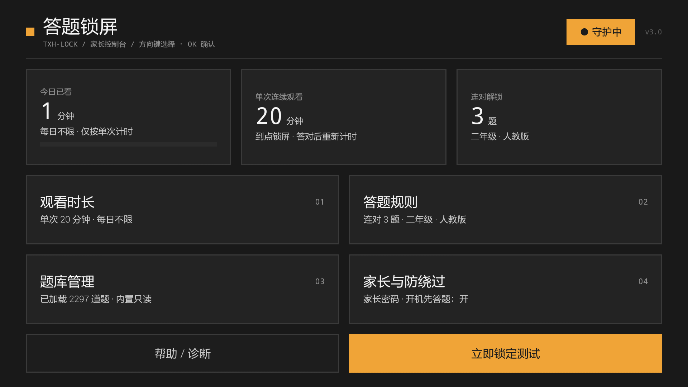
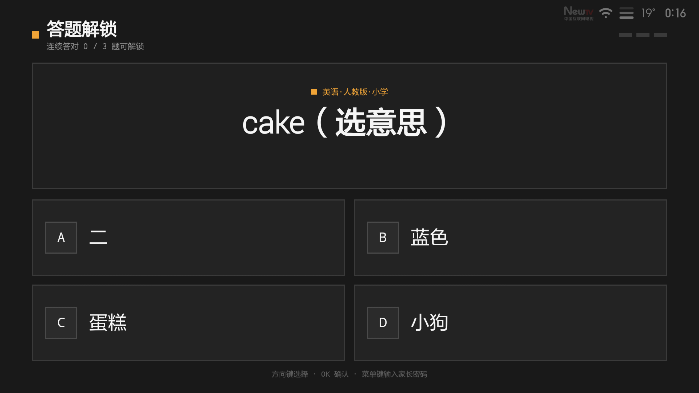

# txhlock · 答题锁屏（小米电视版）v1.9.18

给孩子看的电视加一道「先答题、再看电视」的闸门：看满设定时长自动锁屏，遥控器连续答对几题才解锁。家长可用 PIN 直接解锁，可换题库、调时长、选教材版本。

> **v3.0 三个重点**
> 1. **悬浮层锁屏**：锁屏改成盖在所有应用之上的系统悬浮层 —— 孩子按遥控器主页键，桌面**完全不出现**（不是"闪一下再抢回来"）。
> 2. **回到 1.9.1 的界面**：深海军蓝 + 宝蓝 #1E5AF0、大字号、大按钮；一页放完所有设置，不用一层层点弹层。
> 3. **教材同步题库**：新增人教版 / 北师大 / 苏教版 / 外研版 / 译林版题库，按版本 + 年级出题，内置题量 2000+。




---

## 一、功能一览

| 功能 | 说明 |
| --- | --- |
| 计时锁屏 | 单次连续观看满设定时长 → 自动全屏锁屏 |
| 每日上限 | 可设每日累计观看上限，到点即锁 |
| 答题解锁 | 连续答对 N 题（1~10，默认 3）才解锁，答错清零重来 |
| 悬浮层锁屏 | 锁屏是系统悬浮层，主页键切桌面也会被直接盖住，桌面不出现 |
| 教材同步 | 人教版 / 北师大 / 苏教版 / 外研版 / 译林版 / 通用，按「版本 + 年级」优先出题 |
| 内置题库 | **2000+ 道**：958 道通用题 + 1113 道教材同步题（语文/数学/英语为主），装完即用、离线可用 |
| 十三个题型 | 口算、数学、语文、英语、物理、化学、生物、历史、地理、政治、认字、古诗、自定义 |
| 按年级出题 | 只出该年级及以下的题；某版本题量不足时自动并入低年级，不超纲 |
| 自定义题库 | 放 txt 到电视 `/sdcard/Download/txhlock/` 即导入，与内置题库自动去重 |
| SMB 同步 | 从 Windows 共享自动拉题；Android 4.3 上组件可能不可用，界面会提示 |
| 家长 PIN | 应用内置数字键盘，默认 `1234`，可改 4~8 位 |
| 防重启绕过 | 「开机先答题」开启后，每次真正开机都先锁一次 |
| 遥控器操作 | 一页上下滚动；选中项蓝底 + 白字 + 白框；答案一行 4 个，只需左右移动 |

**系统要求**：Android 4.3（API 18）及以上。已在小米电视 2（MiTV2-49 / Android 4.3 / 1080p）实机验证。

---

## 二、安装

> 有电脑：双击 `安装器\一键安装.bat`，或把一句话发给豆包（Agent 模式）。
> 没电脑：U 盘拷 `txhlock_v1.9.18.apk` 到电视安装。

> **下载地址（任选一个能打开的；国内镜像可备用）**
> 1. jsDelivr：https://cdn.jsdelivr.net/gh/txhtxh11/txhlock@v1.9.18/apk/txhlock_v1.9.18.apk
> 2. 国内加速：https://ghfast.top/https://github.com/txhtxh11/txhlock/releases/download/v1.9.18/txhlock_v1.9.18.apk
> 3. 国内加速 2：https://ghproxy.net/https://github.com/txhtxh11/txhlock/releases/download/v1.9.18/txhlock_v1.9.18.apk
> 4. jsDelivr Fastly：https://fastly.jsdelivr.net/gh/txhtxh11/txhlock@v1.9.18/apk/txhlock_v1.9.18.apk
>
> 安装器脚本（国内镜像）：https://ghfast.top/https://raw.githubusercontent.com/txhtxh11/txhlock/v1.9.18/tools/install.ps1
>
> 文件大小 **4,413,620 字节**，MD5 `f9135e8302b7996bfc8e8834cc91ab31`。

### 方式一：一键安装器

1. 把 `安装器` 文件夹拷到电脑（和电视同一个路由器）
2. 双击 `一键安装.bat`
3. 安装器自动：找 adb → 扫局域网找电视 → 装 APK → 开无障碍 → **授权悬浮层** → 设常亮 → 启动
4. 找不到电视时按窗口 4 步打开 ADB（设置 → 关于 → 产品型号连点 5~7 次 → 开发者选项 → ADB 调试）

### 方式二：豆包一句话全自动

见 `发给豆包的提示词.txt`：一句中文 + 一条命令，豆包会自动找电视、开 ADB、装 APK、配好无障碍和悬浮层；命令里已带国内镜像备用下载。

### 方式三：U 盘

拷 `txhlock_v1.9.18.apk` 到 U 盘 → 电视文件管理器安装 → 手动开「无障碍」和「悬浮窗」。

### 装完必做

| # | 做什么 | 在哪 |
| --- | --- | --- |
| 1 | 打开自启动 | 设置 → 应用 → 答题锁屏 → 自启动 |
| 2 | 打开无障碍 | 设置 → 无障碍 → 答题锁屏（安装器一般已开） |
| 3 | 允许悬浮层 | 设置 → 应用 → 答题锁屏 → 特殊权限 → 显示在其他应用上层（4.3 安装即授权） |
| 4 | 关掉 ADB | 设置 → 开发者选项 → ADB 调试 |

验证：打开应用 → 输 `1234` → 「立即锁定测试」→ 答对 3 题能解锁。

---

## 三、家长设置（v4.0：回到 1.9.1 的一页式布局）

所有设置在一页里，方向键上下滚动即可，不再点开弹层：

```
答题锁屏守护 · 家长设置                        v4.0
当前状态：未锁定

监控开关
[            已开启（点击停用）            ]

单次连续观看（分钟，到点答题解锁）
[   -   ]              20              [   +   ]
看满这个时长就弹锁屏；答对后重新计时。范围 5~120 分钟。

每日累计上限（分钟，0=不限）
[   -   ]               0              [   +   ]
...
教材版本（语文/数学/英语按版本出题）
[人教版] [北师大] [苏教版] [外研版] [译林版] [通用]
启用题型（可多选）
[✓ 口算] [✓ 认字] [✓ 古诗] [✓ 英语]
[ 自定义] [✓ 数学] [✓ 语文] [ 物理]
...
[            立即锁定测试            ]
```

- 大字号、大按钮，3 米外看得清；选中项**蓝底 + 白字 + 白框**（1.9.1 原样）
- 教材版本 6 个一排、题型 4 个一排，带 ✓ 表示已启用
- 一页包含：监控开关、单次/每日/关机重置、连对题数、年级、教材版本、题型、
  题库、SMB 同步、家长密码、开机先答题、悬浮层、无障碍、系统设置、卸载、帮助与诊断

| 区块 | 能改什么 |
| --- | --- |
| 监控开关 | 开/停守护（停用后不计时、不锁屏） |
| 时间 | 单次 5~120 分钟、每日上限、关机/待机重置阈值 |
| 答题规则 | 连对题数、年级、教材版本、13 个题型多选 |
| 题库 | 题量统计、SMB 同步、重新加载、导出内置题库、删除本地题库 |
| 家长与防绕过 | 改密码、开机先答题、悬浮层权限、无障碍、系统设置、卸载 |
| 帮助与诊断 | 主页键方式、无障碍、题库、悬浮层权限、修复入口 |

---

## 四、伪装成「每日壁纸」（v5.0）

在家长设置最上方点「伪装成每日壁纸：开」，桌面图标就会变成 **每日壁纸**。

| 操作 | 看到什么 |
| --- | --- |
| 打开桌面「每日壁纸」 | 一张必应每日一图（无网/4.3 用内置 Unsplash 照片） |
| 短按【菜单键】 | 壁纸设置：每日更新开关、换一张、关闭 |
| 长按【菜单键】10 秒（默认，可调） | 家长密码 → 家长设置 |
| 长按中途松手 | 取消，回到壁纸 |

- 长按时**前 80% 不显示倒计时，最后 20%（默认最后 2 秒）才读秒**，避免孩子发现
- 长按时长在家长设置第一项「长按菜单键进入设置（秒）」里改，范围 3~20 秒

- 从 v1.9.2 起**桌面只有「每日壁纸」一个入口**（不再有「答题锁屏」图标），点击直接进壁纸、不验证
- 如果桌面还显示旧图标/旧名字，重启电视一次即可（重启会断开 ADB）
- 这是**伪装**，不是系统级防卸载；懂行的成人仍可在 设置 → 应用 里卸载

## 五、锁屏与答题

- 到点后锁屏以**系统悬浮层**盖住整个屏幕（含桌面）；没有悬浮窗权限时自动退回 Activity 锁屏
- 顶部进度 + 中间大题目 + **一行 4 个答案**；选中项蓝底 + 白字 + 白框（遥控器只需左右移动）
- 方向键左右选择、OK 确认；数字键 1~4 或 A~D 直接作答
- 答对后 0.6 秒自动下一题、答错 1.6 秒自动下一题，不用多按一次 OK
- 答对绿框 +「✓ 答对了」；答错红框 + 正确答案，并把正确项标绿
- 锁屏时按**主页键/返回键都没有反应**；按【菜单键】输家长密码可随时解锁

---

## 六、自定义题库（重点）

### 放置位置
把题库文件（`*.txt`）放到电视的：
```
/sdcard/Download/txhlock/
```
可用 U 盘拷贝，或通过局域网/SMB/ADB 传过去。放好后到**家长设置 → 重新加载题库**即可生效。
**卸载本地题库**：想清空本地目录里的题库时，在家长设置点【**卸载本地题库**】按钮，会删除 `/sdcard/Download/txhlock/` 下的全部 txt 文件；删除后本地状态显示"本地无题库"（若已开启 SMB，则显示"本地无题库（当前使用 SMB 题库）"，仍用 SMB 同步的题库出题）。
**也可以配置 Windows 电脑共享，实现同步**（见下一节"局域网 SMB 题库同步"）：电脑上改题库文件后，电视打开应用时自动更新、或点【立即更新 SMB 题库】按钮同步，不用 U 盘/ADB。
**可以放多个文件**，应用会全部合并随机出题（如 `一年级.txt`、`二年级.txt` 可并存）。**文件名随意，不影响读取。**

### 文件格式（v1.7 新格式，带年级和干扰项）

```
# 注释行以 # 开头

[chinese@g2]                       ← 段名 = 科目 @ g 年级
"春眠不觉晓"的下一句是？|处处闻啼鸟|夜来风雨声;花落知多少;床前明月光
弯弯的月亮像什么？|小船|大伞;石头;房子

[math2@g2]
小明有 5 个苹果，吃了 2 个，还剩几个？|3 个|2 个;7 个;4 个

[english@g2]
apple|苹果|香蕉;橘子;葡萄
```

一行一题：**`题干|答案|干扰项1;干扰项2;干扰项3`**（第三个字段用中英文分号隔开，题与题之间换行）。

**段名（科目）可写**：`math2` 数学、`chinese` 语文、`english` 英语、`physics` 物理、
`chemistry` 化学、`biology` 生物、`history` 历史、`geography` 地理、`politics` 政治、
`pinyin` 认字（拼音）、`poetry` 古诗、`custom` 自定义。

- **`@g1` ~ `@g9`** = 该题适用的年级（1 小学一年级 … 9 初中九年级）。不写 `@gX` 就是全年级通用（等同于 g9）。
- 程序按「当前年级 → 往下回退」取题：选三年级就只出 g3 及以下的题，**不会超纲**；某个年级题太少时会自动并入低年级题，保证题目池永不为空。
- **不写干扰项也能用**：只有 `题干|答案` 时，程序会从同一题库的其他答案里补足 3 个干扰项；干扰项不够的题会自动跳过，不会出现"选项只有两个"的畸形题。
- 数学口算（`口算` 题型）**不需要写题库**，按年级程序自动生成。
- 答案建议 6 个汉字内，保证电视显示清晰。

> 旧格式（`[pinyin]` + `苹果|ping guo` 这种只有两列、不带年级的写法）**仍然完全兼容**，老题库不用改。

### 内置题库（v1.7 新增，装完即用）

应用已内置 **2000+ 道题**：958 道通用题 + 1113 道教材同步题，随 APK 一起安装，**不需要联网、不需要放任何文件**：

| 文件 | 内容 | 题数 |
| --- | --- | --- |
| `math2_primary.txt` | 数学（小学 g1-g6：应用题/单位换算/找规律/图形，每年级 20） | 120 |
| `math2_junior.txt` | 数学（初中 g7-g9：代数/方程/几何/函数） | 60 |
| `chinese_primary.txt` | 语文（小学 g1-g6：字词/句子/古诗/常识） | 121 |
| `chinese_junior.txt` | 语文（初中 g7-g9：文言/修辞/文学常识） | 90 |
| `english_primary.txt` | 英语（小学 g1-g6：单词/短语） | 120 |
| `english_junior.txt` | 英语（初中 g7-g9：词汇/语法/时态） | 90 |
| `physics.txt` | 物理（初中 g8-g9） | 67 |
| `chemistry.txt` | 化学（初中 g9） | 50 |
| `biology.txt` | 生物（初中 g7-g9） | 60 |
| `history.txt` | 历史（初中 g7-g9） | 61 |
| `geography.txt` | 地理（初中 g7-g9） | 61 |
| `politics.txt` | 政治/道德与法治（初中 g7-g9） | 58 |

**想看清楚内置题库到底有哪些题**：在家长设置点【**导出内置题库（查看/照着改）**】，
12 个 txt 会原样导出到电视 `/sdcard/Download/txhlock/内置题库/`，拷到电脑用记事本打开即可查看、照着改。
（导出目录故意放在题库目录的子文件夹里，**不会被当成题库加载**，导出多少次都不会让题量翻倍。）
桌面交付目录里也放了一份同样的明文：`答题锁屏守护/内置题库/`。

### 教材同步题库（v3.0 新增）

按「教材版本 + 年级」优先出题，题目按各版本年级知识点原创（不复制教材原文）：

| 版本 | 科目 | 年级 | 题量 |
| --- | --- | --- | --- |
| 人教版 | 语文 / 数学 / 英语 | 1-9 / 1-9 / 3-9 | 501 |
| 北师大版 | 数学 | 1-6 | 96 |
| 苏教版 | 语文 / 数学 | 1-6 / 1-6 | 178 |
| 外研版 | 英语 | 3-9 | 193 |
| 译林版 | 英语 | 3-6 | 169 |
| 通用 | 全部（原有题库） | 1-9 | 958 |

- 段名格式 `[科目@版本@g年级]`，例如 `[math@rj@g3]` 是人教版三年级数学
- 在「答题规则 → 教材版本」里切换；切换后语文/数学/英语优先抽该版本对应年级的题
- 某版本某年级题量不足时自动并入低年级，仍不会超纲
- 口算、认字、古诗不受版本影响

### 内置题库只读：外部题库只能"加题"

**内置题库是只读的**：它打在 APK 里，程序里没有任何代码会去删它或改写它，界面上也没有删除 / 覆盖的入口。

**本地 txt 与 SMB 题库只有"新增"能力**：

- 加载顺序固定为 **内置题库 → 本地 txt → SMB 缓存**，先加载者占位，后来者撞上「同段落 + 同题干」直接跳过；
- 所以你在 `[chinese@g2]` 里写一道和内置题一模一样的题、答案还写错，**错的进不来，孩子看到的仍是内置那条正确的**；
- 反过来，内置题库里没有的题会正常补进来，题量增加；
- 想撤掉自己加的题：删掉那个 txt（或点【删除本地题库文件】）再【重新加载题库】即可，内置题库不受影响。

页面下方会显示当前题量（如 `已加载 1184 道题（内置 + SMB 题库），共 45 个知识段`）。

> 这条规则已写成自动化测试 `QuizProtectTest`：造一个"故意覆盖"的题库文件，验证答案仍是内置的、新题能补进来、删文件后题数复原 —— 8 项断言全过。

> 想知道内置题库长什么样、照着写自己的题：桌面交付目录的 **`内置题库\`** 里放了全部 12 个内置题库原文（`chinese_primary.txt`、`math2_junior.txt` 等）和合成版 `内置题库-合集.txt`，格式与写法一目了然。

### 局域网 SMB 题库同步
如果题库放在 **Windows 电脑的共享文件夹**里，可让电视从局域网同步。**不再每 30 秒轮询**（电脑不是时时在线）：改为**每次打开应用时自动同步一次**，另设手动"立即更新 SMB 题库"按钮，更新成功会在 SMB 状态区显示"上次更新：`yyyy-MM-dd HH:mm:ss`"。

**在电视上配置一次：**
1. 电脑上：把题库文件夹设为共享（右键文件夹 → 属性 → 共享 → 共享给 Everyone 或指定账号，并允许**读取**）。
2. 电视上：家长设置 → **SMB 同步设置** → 填写：
   - 服务器 IP 或主机名（电脑局域网 IP，如 `192.168.1.100`；电脑上按 `Win+R` 输入 `cmd`，再输 `ipconfig` 可查）
   - 共享名（共享文件夹名）
   - 用户名 / 密码（Windows 登录账号密码；设了 Everyone 且允许匿名可留空）
   - 共享内子目录（可选，填共享里放题库的子文件夹路径，如 `一年级`）
3. 点【保存并启用】→ 自动测试连接并立即同步一次，页面显示结果。
4. 之后：
   - **每次打开应用**会自动同步一次，电脑在线且共享文件有增改就会拉到新题。
   - 想随时更新：在家长设置 → SMB 区域点【**立即更新 SMB 题库**】按钮。
   - **点"立即更新"后的提示**：题库有变化 → "更新成功 + 时间 + 更新 N 个文件"；连接正常但题库没变化 → "题库没有变化，无需更新（上次更新：时间）"；连接不上（电脑没开机/共享未开）但有过成功历史 → "连接失败，题库沿用上次（时间）"；从未成功 → "更新失败，请检查地址/账号/网络"。不会误报"更新失败"。
   - **SMB 配置弹窗**：内容较多时弹窗可滚动；软键盘回车键显示"下一项"，可顺序跳到下一个输入项（最后一项为"完成"收起键盘），遥控器也能用方向键逐项移动。
   - 同步成功，SMB 状态区显示"上次更新：`2026-11-01 12:47:16`"这样的日期时间；电脑不在线/共享不可达会提示"更新失败"，不影响本地题库使用。

> 说明：应用只把共享里的 `*.txt` 同步到电视内置空间缓存，**不修改电脑文件**；电脑关机/断网时同步失败并提示，本地题库照常使用。仅拉取 `.txt` 文件。

---

## 七、防绕过说明（务必了解）

**v3.0 起锁屏优先使用系统悬浮层**：锁屏窗口盖在所有应用之上，孩子按遥控器主页键，桌面会被直接盖住（不是先闪一下再抢回）。Android 4.3~5.1 安装即授权；Android 6+ 需要在系统里允许「显示在其他应用上层」，安装器会尝试用 adb 自动授权。没有悬浮窗权限时，自动退回无障碍 + 秒级抢回的方案，功能不受影响。

- **已实现**：返回键拦截、全屏铺满、锁屏状态持久化、开机自启、被切走（按 HOME）后自动重新拉起。
- **主页键真正拦得住（v1.9 起）**：无障碍服务通过 `FLAG_REQUEST_FILTER_KEY_EVENTS` 拿到按键过滤权，锁定状态下**在系统分发前就把 HOME 吞掉** —— 小米桌面不会被启动，屏幕上什么都不会发生。实测日志 `HOME key swallowed`，前台保持在锁屏页。
- **唯一的脆弱点**：小米电视会在某些时机（尤其是覆盖安装后）保留无障碍服务的名字却**不再绑定它**。此时按键过滤失效，只能退回"轮询抢回"。v1.9 的处理：
  - 设置页把状态分成三档，直接显示 `✅ 已物理拦截` / `⚠ 被系统解绑` / `❌ 未开启`；
  - 检测改读 `AccessibilityManager.getEnabledAccessibilityServiceList()`（系统真实绑定列表），不再看 settings 字符串（那玩意儿会骗人）；
  - 拦截失效时把抢回间隔从 3 秒压到 **0.8 秒**，桌面最多闪一下；
  - 家长输完密码进设置页时弹一次提示（24 小时节流），点【去修复】直达辅助功能页。
- 如需**更强的真锁死**（HOME/设置都被禁用），可用 ADB 把本应用设为设备所有者（Device Owner），见下文进阶。

### 进阶：ADB 设为 Device Owner（可选，更强锁定）
在电脑上安装 platform-tools（已随本机 SDK 提供），连接电视后执行：
```
adb connect <电视IP>:5555        # 先开启电视的"网络调试/ADB调试"
adb install -r txhlock.apk
adb shell dpm set-device-owner com.kidslock/.MainActivity
```
设置后系统会进入 kiosk 模式，HOME 键也无法退出锁屏。**注意**：设设备所有者后如需卸载，须先 `adb shell dpm remove-active-admin com.kidslock/.MainActivity`。

---

## 八、常见问题

- **装了不锁屏？** 确认监控开关已开启；检查应用是否被系统禁止自启动/后台运行。
- **关一下机再开，计时会不会被清零？** 不会。默认「长关机重置阈值」30 分钟：关机/重启**不超过**30 分钟，单次计时接着走（关机这段时间不算观看），关机前是锁屏的开机仍然锁屏；**超过**30 分钟只清零"本次连续观看"并解锁，**今日已看时长保留**；只有**跨过晚上 12 点**才把今日额度一起清零。阈值按 15 分钟一档调整，设成 0 则不限（只有跨夜清零）。
- **长关机、跨夜之后为什么是解锁的？** 长关机视为"休息够了"：本次连续观看清零并解锁；但**如果今天额度已经用完**，仍然保持锁定（只能用家长密码豁免），避免靠关机刷每日额度。跨夜是新的一天，连今日额度一起清零后解锁。判定在开机广播、无障碍启动、计时服务启动、屏幕点亮、以及锁屏页显示前都会各做一次，另外锁屏页每秒自查一遍状态。
- **PIN 怎么输？** 锁屏时按【菜单键】→ 屏幕弹出数字键盘（1-9/删除/0/确认），方向键选数字、OK 键按，输满自动校验。方向键移动时当前选中的数字会**高亮亮橙色**，一眼可见当前在哪。
- **进不了家长设置？** 进入设置需先输家长 PIN（默认 1234），输不对会被拦在门外。
- **自定义题库没生效？** 确认文件名 `.txt`、放在 `Download/txhlock/`、段名写对（`[english@g3]` 这种），然后点"重新加载题库"；首次安装需在设置里允许"所有文件访问"权限。
- **我写了道和内置题一样的题想改答案，怎么没变？** 这是故意的：内置题库只读，外部题库只能加题、不能改题。内置题里同段落同题干的题永远以内置版本为准。真想换个说法，请把题干改得不一样（比如加个「（家长版）」前缀），它就会作为一道新题补进来。
- **选了初中还是出小学题？** 检查年级是否真的是 7~9 年级（`+`/`-` 调到"七年级"以上），以及题型里有没有勾选对应学科（物理只有 g8-g9 有题、化学只有 g9 有题，选低年级时该科自然没题）。某一科题量不足时会自动并入低年级题，属正常。
- **想看看内置题库都出了些什么题？** 家长设置点【导出内置题库（查看/照着改）】，电视 `/sdcard/Download/txhlock/内置题库/` 下会生成 12 个 txt，拷到电脑就能看。桌面交付目录里也有同样的明文副本。
- **改文件名/分年级文件不影响？** 不影响，应用读取该目录下所有 `.txt` 并合并。
- **SMB 同步没生效？** 确认电脑共享已开启、电脑在线、填的 IP/共享名/账号密码正确，且电脑与电视在**同一局域网**；先在设置里点【保存并启用】或【立即更新 SMB 题库】看是否提示"更新成功 + 时间"；共享建议允许读取权限。
- **答对了还锁定？** 需要**连续**答对设定题数，中间错一题就清零。
- **每日额度用完还在锁？** 这是防沉迷设计：每日上限到点后，孩子答对题也无法继续看，需家长在锁屏页按【菜单键】输入家长密码，**当日豁免**后才能继续；第二天额度自动恢复。
- **答完题跑出「家长验证：请输入密码」？（v1.9.1 已修）** 这是旧版的 bug：锁屏页和设置页挤在同一个任务栈里，答完题关掉锁屏页后，栈底的设置页就浮上来了，而它一启动就要家长密码。v1.9.1 起锁屏页独占一个任务栈，答完题直接回桌面/原应用。如果你的还是旧版，覆盖安装 v1.9.1 即可。
- **怎么改家长密码？** 家长设置 →【修改家长密码】，验证旧密码后输入新密码（4-8 位）并确认。

---

## 九、技术实现（开发者参考）

- **Java + Android framework**，题库同步引入 `jcifs-ng`（SMB 客户端）第三方库。
- 核心类：
  - `QuizService`：前台服务累计计时（含跨午夜、每日累计），到点触发锁屏
  - `Away`：关机/重启/待机"离开"后的计时接续判定（短离开暂停续时 / 长离开清零 / 跨夜清零），全应用唯一入口
  - `LockScreenActivity`：全屏答题锁屏页（v1.9.1 起带独立 `taskAffinity`，独占任务栈，解锁 `finish()` 后不会把家长设置页顶到前台）
  - `PinPad`：应用内置数字键盘（锁屏与设置共用）
  - `QuizEngine`：出题/判题（13 题型分派；口算按 1~9 年级自动生成，含负数/根式/乘方；学科题走「年级向下回退」取池；每题优先用自带干扰项，不足才从同池补）
  - `QuizLoader`：题库解析（三源：APK 内置 assets → 本地 `/sdcard/Download/txhlock/` → SMB 缓存；段名 `[科目@g年级]`、行格式 `题干|答案|干扰项1;干扰项2;干扰项3`；跨源去重，内置题库固定先加载 → 外部只增不改；内置题库导出）
  - `SMBHelper`：局域网 SMB 同步（jcifs-ng），清单指纹检测变化；打开应用时自动同步 + 手动"立即更新"按钮，成功记录时间
  - `KeyFilter`：无障碍服务"真实绑定状态"检测（v1.9）。查 `AccessibilityManager.getEnabledAccessibilityServiceList()` 而非 settings 字符串，同时判断是否拿到按键过滤能力
  - `BootAccessibility`：无障碍保活 + 锁定状态下吞掉遥控器主页键（`FLAG_REQUEST_FILTER_KEY_EVENTS`），并负责"别的应用抢前台立刻拉回"
  - `MainActivity`：家长设置（含 PIN 门禁、SMB 配置、权限引导、无障碍三档状态显示与修复弹窗）
  - `BootReceiver`：开机自启
  - `Prefs`：设置与锁屏状态持久化（含 SMB 配置）
- 构建：Gradle 8.13 + AGP 8.7.3 + JDK 17。工程已带 **Gradle Wrapper**（命令行 `gradlew.bat assembleRelease`），也可用本机 Gradle 直接 `gradle assembleRelease` 构建。
- 权限：开机自启、前台服务、通知、读题库存储、局域网网络（INTERNET，SMB 访问用）。
- 内置资源：`assets/quiz/*.txt`（12 个题库）、`assets/fonts/pinyin.ttf`（DejaVu Sans 46KB 子集，只用于纯拉丁选项的拼音/英文渲染；许可证与生成命令见同目录 `LICENSE-DejaVu.txt`）。

---

## 十、更新记录

### v4.1

- **家长验证完全回到 1.9.1**：`#1F1F1F` 直角面板、白色密码框、紫色按键 `#333355`、选中橙色 `#E8963C`
- **已验证进入设置后，遥控菜单键不再弹验证**；只有锁屏时才用菜单键呼出家长密码
- 进入设置后本次不再重复验证（去掉了 8 分钟重新验证）

### v1.9.18（当前）

- **题库区恢复「本地题库怎么加」说明**：把 txt 拷到 `Download/txhlock`，再点「重新加载题库」；一行一题：`题目|答案|错误1;错误2;错误3`
- **所有提示改成小白能看懂的一句话**：长按 10 秒只最后 2 秒倒计时、长关机保留今日已看、主页键没反应怎么修
- **安装器 + 仓库补国内镜像**：jsDelivr / ghfast / ghproxy / Fastly 四个下载地址，装了自动按顺序回退
- **豆包一句话更新**：一条命令全自动装好，GitHub 打不开时自动换国内镜像

### v1.9.4

- **修复电视上锁屏页崩溃**：部分 MIUI Android 4.3 的二进制 XML 解析器在 `activity_lock.xml` 上抛 `StringBlock index out of bounds`；锁屏界面改为**纯代码构建**，不再 inflate 该 XML
- **修复设置页/弹窗关闭后"卡住"**：门禁消失、弹窗关闭后焦点会落在已移除的视图上，遥控器方向键没反应；现在门禁和所有弹窗关闭后都会把焦点还给原按钮
- 以上均为电视实测发现并验证

### v1.9.3

- **修复「开机先答题 = 关」时重启会清掉锁屏/计时**：之前 `Keeper.lockOnBoot` 在关闭分支里无条件 `setLocked(false)` + `sessionStart=0`，孩子重启一次就能绕过短关机保留锁屏的规则
- **修复长关机清零把「今日已看」也清掉**：现在长关机只清本次连续观看并解锁，今日累计额度保留；今日额度用完时继续锁定，不能靠关机刷额度
- **熄屏即记时间**：新增 `ACTION_SCREEN_OFF` 记录，离开时长从熄屏那一刻算起（不再有最多 5 秒误差）
- 文案：长关机阈值 0 改为「不限」（跨夜仍清零）；说明里写清长关机保留今日额度

### v1.9.2

- **桌面只保留「每日壁纸」入口**：点击直接进壁纸，不再先弹家长验证；家长设置独立任务栈，不会被桌面图标顶到前面
- **长按改为 10 秒**：前 8 秒完全不显示倒计时，最后 2 秒才读秒；时长可在设置里改（3~20 秒）
- **修复从「自启动/无障碍」系统页返回后卡住**：返回时自动恢复焦点；已验证状态在页面重建后保留，不重复验证
- **去掉左上角「当前状态：未锁定」**，避免家长误解
- 版本号改为 **1.9.2**

### v5.0

- **壁纸伪装（防卸载）**：设置里开启「伪装成每日壁纸」后，桌面图标和名称变成「每日壁纸」
- 打开是必应每日一图；4.3 电视不支持必应要求的 TLS 1.2 时，自动用内置 Unsplash 照片，每天轮换
- **短按【菜单键】** = 壁纸设置（换一张 / 每日更新 / 关闭）；**长按 10 秒（可调）+ 家长密码** = 家长设置
- 通知、应用名、无障碍名称也一起改成「每日壁纸」
- 说明：这是"伪装"不是系统级防卸载，懂行的成人仍可在系统设置里卸载；目的是让孩子不把它当锁屏软件

### v4.0

- **界面回到 1.9.1**：深海军蓝 + 宝蓝 #1E5AF0、大字号、大按钮、圆角 14dp
- **家长设置改回一页到底**：所有设置同屏滚动，不再点开五个弹层（少进入/少返回）
- **锁屏答案改成一行 4 个**：遥控器只需左右移动，长答案自动缩小字号，整行统一字号不换行不齐
- **减少动作**：进锁屏默认停在 A、确认框默认停在「确认」、答对/答错自动下一题、数字键 1~4 直接作答
- 保留 v3 的能力：悬浮层锁屏（主页键不露桌面）、教材版本题库 2000+、无障碍保活、SMB 同步

### v3.0.1

- **题库质量修正**：时间题、圆的周长/面积题、小数加法题补齐同类型干扰项，不再出现「3 时 30 分」和「72」混在一起的选项

### v3.0

- **悬浮层锁屏**：新增 SYSTEM_ALERT_WINDOW 悬浮层，主页键切桌面也会被直接盖住；无权限时自动退回 Activity
- **控制台 UI**：零圆角 + 琥珀强调 + 等宽数字，重做主页、五个弹层、锁屏页、家长键盘
- **教材同步题库**：新增人教版/北师大/苏教版/外研版/译林版 1113 道题，按版本+年级出题
- **锁屏逻辑复用**：QuizPanel 同时服务 Activity 与悬浮层，行为一致
- **诊断如实显示**：悬浮层覆盖 / 无障碍拦截 / 秒级抢回 三档

### v2.0

- **界面全部重做**：卡片式仪表盘 + 居中弹层，一屏放完、左右对称、统一圆角/间距/字号；遥控器焦点放大 + 蓝色描边
- **Android 4.3 兼容修复**：4.3 上不再退化 Holo 主题（values-v21 拆分）；去掉 4.3 没有的 API 依赖；SMB 失败不再崩进程
- **电视自适应**：按屏幕宽度把设计稿归一到 960dp，1080p/720p/4K 电视等比放大，不再出现界面缩成一小块
- **锁屏页重做**：2×2 选项卡 + 进度圆点 + 大字号题目自动缩放，长题/长选项不裁字
- **逻辑修复**：每日上限时答对不再假解锁；返回键双保险；家长验证 8 分钟内免重复输入；权限页不再每次启动强跳
- **新增一键安装器**：自动找 adb、扫局域网找电视、安装、自动开无障碍、保持常亮；豆包一句话全自动
- **如实显示主页键拦截状态**：真收到过 HOME 才算「已物理拦截」，否则显示「秒级抢回」并按 0.8 秒节奏抢回

### v1.9.1
- **修复：孩子答完题后不回首面/原应用，而是冒出「家长验证：请输入密码」界面。**
  - 现象：锁屏答对 3/3 后屏幕上出现家长密码框；不输密码只能按 HOME 键逃到桌面，切换时还卡一下。
  - 根因是**任务栈**，与答题逻辑无关：`LockScreenActivity` 原来只有 `singleTask`、没有独立 `taskAffinity`，被 `NEW_TASK` 启动时压进了 `MainActivity` 所在的同一个 task。`unlock()` 里 `finish()` 掉锁屏页后，**栈底那个设置页就浮了上来**，而 `MainActivity.onCreate()` 第一件事就是 `showPinGate()`，且该弹窗 `setCancelable(false)` —— 所以只能按 HOME 把它甩到后台。
  - 修复三处：
    1. `AndroidManifest` 给 `LockScreenActivity` 加 `android:taskAffinity="com.kidslock.lockscreen"`，锁屏页从此独占一个任务栈，不再压在设置页上面；
    2. `MainActivity.onPause()` 里判断到"已锁屏"就 `finish()` 掉设置页（**必须用 `onPause`**：实测锁屏页跑到独立 task 后设置页只收 `onPause`，`onStop` 40 秒都不来）；
    3. `unlock()` 提前置 `sForeground=false` 并 `overridePendingTransition(0, 0)`，去掉解锁瞬间的退场动画拖影。
  - 实测（电视）：锁屏时设置页从活动栈消失；答题 3/3 与"菜单键 + 家长密码"两条解锁路径都直接回桌面/屏保，**均无密码框**。
- **文档：安装章节重写** —— 新增「方式一：让电脑上的豆包 Agent 帮你装」（小白首选，3 步），并把安装包同时放到 GitHub Release 与仓库 `apk/` 目录，供直接下载校验。
- `versionCode 32 / versionName 1.9.1`，与 v1.9 相同调试签名，可直接覆盖安装、不丢设置。
- 提醒：覆盖安装后小米系统大概率又会解绑无障碍，装完请到 **设置 → 辅助功能 → txhlock** 关一次再打开（状态显示 `✅ 已物理拦截` 才算好）。

### v1.9
- **主页键拦截加固：从"靠猜"改成"能看到、能自愈"。** 起因是一次真实故障：电视上按主页键回到了小米桌面，而设置页却还显示"无障碍已开启"。
- 根因不是代码被改坏（v1.7 与 v1.8 的 `BootAccessibility` 逐字节相同），而是小米电视**保留无障碍服务的名字、却不再绑定它**：
  - `settings get secure enabled_accessibility_services` 里名字还在；
  - `dumpsys accessibility` 却是 `services:{}` / `accessibilityEnabled=false`；
  - 于是 `onKeyEvent` 一次都没被调用，HOME 直接派发给 `com.mitv.tvhome`。
- 修复与加固：
  - 新增 `KeyFilter` 工具类，改用 `AccessibilityManager.getEnabledAccessibilityServiceList()` 判断**真实绑定状态**，不再信任 settings 字符串；
  - 设置页状态改成三档：`✅ 已物理拦截` / `⚠ 被系统解绑` / `❌ 未开启`，失效时用橙红色显示；
  - 家长输完 PIN 进设置页时弹一次提示（`Prefs.lastKeyHintMs` 做 24 小时节流），写明后果与修法，点【去修复】直达辅助功能页；
  - 兜底轮询自适应：拿到按键过滤时 3 秒一次，**没拿到时 0.8 秒一次**（改用 `Keeper.launchLockNow`，绕开 `launchLock` 的 1.5 秒节流）；每 10 秒复查一次，修好后自动退回 3 秒，不用重启应用；
  - `BootReceiver` 日志补上 `accBound` 与 `keyFilter` 两项，排查时能直接看出服务在不在跑。
- 实测：注入真实 HOME（`sendevent /dev/input/event2 1 102 1`，红外接收器节点，shell 在 input 组）→ 日志 `HOME key swallowed`，前台仍是 `LockScreenActivity`，`tvhome` 未被启动；`dumpsys accessibility` 显示 `capabilities=8`（CAN_FILTER_KEY_EVENTS）。
- 顺带修正：设置页"已开启"的判定以前用的是 settings 字符串，会把"名字还在、服务没跑"误判成正常，这次一并改掉。
- `versionCode 31 / versionName 1.9`，与 v1.8 相同调试签名，可直接覆盖安装、不丢设置。

### v1.8
- **内置题库改为只读保护：删不掉、也覆盖不掉。**
  - 移除设置里的【冲突处理】按钮（原来有「覆盖内置题 / 只添加」两档），现在**只有一种行为**：内置题库先加载，本地 txt 与 SMB 题库只能补新题；
  - 撞上「同段落 + 同题干」的外部题会被直接跳过 —— 即使它把答案写错，也顶不掉内置题；
  - 界面上再没有任何入口能删除或改写内置题库（【删除本地题库文件】只删你自己放进 `Download/txhlock/` 的 txt，不递归、不碰子目录、碰不到内置题库，且弹二次确认）；
  - 说明文案改成明写这一点，避免家长以为"能覆盖"。
- 新增自动化测试 `QuizProtectTest`（8 项断言）：造一份"故意覆盖 + 新增"的题库文件，验证覆盖被拒、新题并入、删文件后题数复原。
- 电视实测：加一个含"同题错答案 + 1 道新题"的 txt → 题量 1184 → **1185**（只 +1，重复那道被吃掉），删掉该文件后回到 1184。
- `versionCode 30 / versionName 1.8`，与 v1.7 相同调试签名，可直接覆盖安装、不丢设置。

### v1.7
- **题库大扩充：内置小学 1~6 年级 + 初中 7~9 年级共 958 道题 / 42 个知识段**，随 APK 安装即用，不联网、不放文件也能出题：
  - 数学（文字题/应用题/几何/单位换算/找规律，小学 122 + 初中 60）、语文（121 + 90）、英语（120 + 90）、物理 67、化学 50、生物 60、历史 61、地理 61、政治 58。
  - **每题自带 3 个干扰项**，选项质量靠得住（不再靠随机凑数，不会出现"3 个选项里两个明显不是数"这种一眼假）。
  - 题型从 5 个扩到 **13 个**：口算 / 数学 / 语文 / 英语 / 物理 / 化学 / 生物 / 历史 / 地理 / 政治 / 认字 / 古诗 / 自定义，可任意多选。设置界面题型按钮改为 4 行布局，电视上不挤。
- **年级控制从「口算难度 1~6 级」升级为「1~9 年级精确匹配」**：口算扩到 9 年级（七年级起为有理数/乘方/根式/分数），各学科题库按年级向下回退取题（选三年级只出 g3 及以下，**不会超纲**；题量不足自动并入低年级题，保证题目池不为空）。
- **题库三级加载 + 自动去重**：APK 内置 assets → 电视 `/sdcard/Download/txhlock/` 本地 txt → SMB 同步缓存。三源合并时按「题干+答案」自动去重，同名题只留一道。
- **新增「冲突处理」按钮（覆盖 / 只添加）**：覆盖=你的题赢（默认，适合改内置题）；只添加=内置优先、你的题只补新题。点一下即时切换并重新加载，状态栏同步显示当前题量。<br>*（v1.8 起该按钮已移除：内置题库改为只读，外部题库只能加题。）*
- **新增「导出内置题库」按钮**：把 12 个内置题库明文导出到 `/sdcard/Download/txhlock/内置题库/`，方便家长查看、照着改。导出目录是题库目录的子文件夹，**不会被误当题库加载**（实测导出后题量不变）。
- **修复「拼音声调符号显示成又宽又带空隙」**：电视系统字体 DroidSans **缺 `ǎ ǐ ǒ ǔ ǚ`**（Latin Extended-B 里的带声调元音），只有 `ā ē ī ō ū ě ì ú` 这些 Extended-A 的才有；缺字时系统回退到中文字体，于是 `wǒ` 被画成「w ǒ」。现在 APK 内置了一个 **46KB 的 DejaVu 子集字体**（只含拉丁字母与声调符号，随包许可齐全），锁屏选项只要是**纯拉丁内容**（拼音、英文单词）就用它渲染，含汉字的选项仍走系统字体。实测 `gǒu / mǎ / shù / bāo` 已与 `dì / yú / shān` 一样整齐。
- **与 v1.6 相同调试签名，可直接覆盖安装、不丢设置**（`versionCode 26 / versionName 1.7`）。
- 题库内容为按现行教材大纲逐条撰写（非网络抓取），已做过校验：42 个段落全部 3 个干扰项、无重复题干、无重复选项、无分隔符 `|` 冲突。

### v1.6
- **修复「长关机/跨夜后开机仍然停在答题锁屏」**，三处根因逐个修掉：
  1. **长关机被"每日额度"挡住**：v1.5 里长离开分支写着"每日额度已用完就不放开"，结果只要锁屏是每日上限触发的，关机再久也**只清零计时、不解锁**，而且答题永远解不开（答题解锁被每日上限拦截），只能输家长密码 —— 与"长关机重置清零"直接冲突。现在长关机与跨夜统一走同一套彻底清零：单次计时从 0、解除锁定、当日额度与家长豁免一并清掉。
  2. **锁屏页不会自己退出**：电视"关机"多数是待机，唤醒时系统会先把锁屏页恢复显示，而清零判定要稍后才跑完；页面已在前台就没人再检查状态，于是**一直停在答题界面**。现在锁屏页在 `onCreate`/`onResume` 显示前先判定一次，并每秒自查一次状态，判定已解锁就自动关闭。
  3. **开机时钟比关机时还早会死锁**：电视盒子 RTC 未同步是常事，v1.5 遇到"时间戳在未来"直接返回"正常"并保留锁定，于是**永远不解锁**。现在回拨小于 1 分钟当抖动忽略，超过 1 分钟视为时间不可信 → 清零解锁（宁可多放一次，也不把人锁死）。
- 与 v1.4/v1.5 相同的调试签名，可直接覆盖安装、不丢设置（`versionCode 24 / versionName 1.6`）。

### v1.5
- **修复「拼音/英文答案被强制全大写」**：锁屏答题的四个选项按钮用的是 Material 主题的原生 `Button`，Android 5.0+ 的 Material 样式默认 `textAllCaps=true`，会把答案文字整体转大写 —— 题库里的 `rén`、`kāi` 显示成 `RÉN`、`KĀI`，英语题 `apple` 显示成 `APPLE`。现在锁屏选项按钮、以及家长设置页的按钮样式统一关闭自动大写，**题库里怎么写的就怎么显示**（拼音保持小写带声调）。题库文件本身无需改动。
- 与 v1.4 相同调试签名，可直接覆盖安装、不丢设置（`versionCode 23 / versionName 1.5`）。

### v1.4
- **关机/重启不再重置计时（重做"离开判定"）**：新增 `Away` 统一判定，规则改为——
  - **短关机/重启**（离开时长 < 「长关机重置阈值」，且未跨夜）：单次计时**接着走**（离开的时间不算观看，等于暂停），锁屏状态原样保留 —— 关机前锁着屏，开机**仍然锁屏**；关机前没锁屏，开机按累计时长决定要不要锁。
  - **长关机**（离开时长 ≥ 阈值）：清零、解锁，开机从 0 计时（视为真正休息过）。
  - **跨夜**（离开期间跨过本地零点）：**强制**清零、解锁，并清掉上一天的每日额度与家长豁免。
- **新增「长关机重置阈值」设置**（家长设置第 4 项，默认 30 分钟，±5 分钟一档，0=关闭本项仅保留跨夜清零）。旧版拿"单次连续观看"当关机判定阈值，家长无法单独控制，现已彻底解耦。
- **修复「长关机后开机仍锁屏」**：`BootReceiver` / 无障碍 / 服务启动现在都**先做离开判定、再决定是否拉起锁屏**；锁屏页 `onCreate/onResume` 增加状态校验，看门狗或补拉在"已清零解锁"之后迟到的拉起会自行退出，不再把刚解开的锁又锁回去（旧版 `LockScreenActivity.onCreate` 无条件 `setLocked(true)`，正是长关机也逃不掉锁屏的元凶之一）。
- **修复「家长密码当日豁免无效」**：旧版豁免时把 `dailyLocked` 置回 `false`，而当日累计早已超上限，下一秒又判超限锁上，家长密码等于白输。现改为独立的 `dailyExempt` 标记（当天不再因每日上限锁屏，次日自动清除）；家长用密码解"单次"锁屏则不会误触发豁免。
- **修复「待机时长被算进单次观看」**：文档一直写"屏幕熄灭不计时"，但旧版只在断档超过单次限额时才重置起点，短待机时长实际被计入了观看时长。现在短离开一律按"暂停"处理，账面与说明一致。
- **性能/稳定性**：心跳时间戳由"每秒写盘"改为 5 秒节流；通知栏只在分钟数变化时刷新；`tick` 增加异常兜底，单次异常不会再让计时循环中断。
- 与 v1.3 相同调试签名，可直接覆盖安装、不丢设置（`versionCode 22 / versionName 1.4`）。

### v1.3
- **修复"关机前已锁屏 + 关机超单次限时仍开机锁屏"（断档检测改为无条件解锁）**：v1.2 的断档检测带 `起点 != 0` 前提，而 `doLock()` 锁定时会把单次起点置 0——关机前已处于锁屏时起点为 0，恢复判定被挡住，导致关机超限时开机锁屏延续。v1.3 将断档检测改为**无条件**清零解锁：只要"距上次正常 tick 超过单次限时"（即经历关机/待机断档），无论关机前是否已锁屏、起点是否为 0，一律清零起点并解除锁定（开机不锁、从 0 重新计时）；未超限时则延续关机前状态（关机前已锁屏则继续锁屏，未锁则续上计时）。实测：关机前已锁屏 + 关机 10 分钟再开机 → 自动解锁不锁屏。
- 与 v1.2 相同调试签名，可直接覆盖安装、不丢设置。

### v1.2
- **关机/待机恢复改为"计时断档检测"，不再依赖屏幕点亮广播（彻底杜绝"关机超限额开机仍锁屏"偶发）**：v1.1 的恢复判定仍靠屏幕点亮广播触发，实测小米电视待机/开机时该广播偶发不可靠——若关机前已处于锁屏，恢复未触发则锁屏延续。v1.2 改为在 tick 内自行检测"计时断档"：距上次正常 tick 超过单次限额即视为关机/待机恢复，再判定——单次起点距今超单次限额 → 清零起点并解除锁定（开机不锁、从 0 重新计时）；未超限额 → 延续关机前状态（关机前已锁屏则继续锁屏，未锁则续上计时）。不依赖任何屏幕广播，开机第一拍 tick 即完成恢复。
- 与 v1.1 相同调试签名，可直接覆盖安装、不丢设置。

### v1.1
- **屏幕熄灭即暂停计时（修复"关机超限额开机却锁屏"）**：v1.0 仅靠屏幕点亮广播重置起点，待机重启时 `tick` 可能先于广播把整个关机时长算进单次计时，导致关机超限额开机仍直接锁屏。v1.1 改为屏幕熄灭即暂停计时（tick 检测屏幕状态，熄灭时不累计、不触发锁定）；恢复判定规则同 v1.2（超限额清零解锁、未超延续）。
- 与 v1.0 相同调试签名，可直接覆盖安装、不丢设置。

### v1.0
- **修复"单次到点不锁屏"回归 bug**：v0.8 把"起点超过单次限额"当陈旧起点在每秒计时里重置，导致单次计时一旦到点就被吞掉、永远不触发锁定（设短时长如 3 分钟即现形）。v1.0 移除该重置，单次到点正常锁定。
- **关机/待机不计入单次计时**：新增监听屏幕点亮广播，待机/关机恢复时重置单次起点，关机时长不再算进"连续观看"——长关机/隔夜再开机不会因把关机时间算进去而直接锁屏；断电/强杀重启仍由服务启动时的超限额重置兜底，跨夜由跨零点重置兜底。
- 与 v0.9 相同调试签名，可直接覆盖安装、不丢设置。

### v0.9
- **口算难度级别选择**：家长设置新增「口算难度级别」1～6 级，对应小学一~六年级。口算**由应用按年级自动出题、无需题库**（不依赖电脑/网络）：一~二年级加减+表内乘法，三年级起加入两三位×一位与整除，四~六年级逐步加大数四则与两位数乘除。按孩子年级选好级别即可自动适配。
- 与 v0.8 相同调试签名，可直接覆盖安装、不丢设置。

### v0.8
- **修复隔夜/长关机残留锁屏**：开机后检测到会话起点早于今日零点（跨夜/长关机），或起点已超过单次限额（残留状态）时，自动把会话起点重置为当前时间、从 0 重新计时，电视关一整夜再开机不再直接进入答题锁屏。已锁定状态仍保持锁定（防绕过不受影响）。此版本用与 v0.7 相同的调试签名，可直接覆盖安装、不丢设置。

### v0.7
- **应用图标**：代码绘制「L」字母图标（蓝底白字，替代旧「答」字图标，无水印）。
- **重启/关机跟随锁定状态**：未锁定 → 重启/关机后不锁屏、计时续上；已锁定 → 重启/关机后仍锁屏（防绕过）。
- **长关机优化**：未锁定且上次计时起点距今已超过单次限额时，重置计时起点，避免隔夜开机误锁。

### v0.6
- 统一设置界面提示文字行距；修复若干问题。